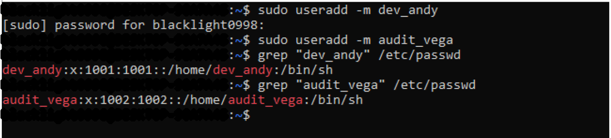
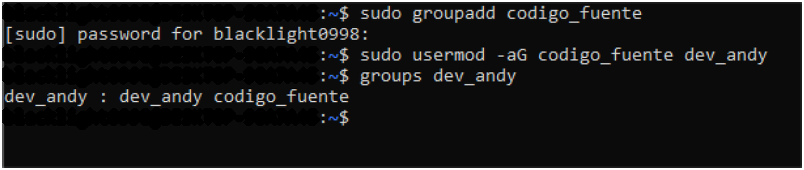
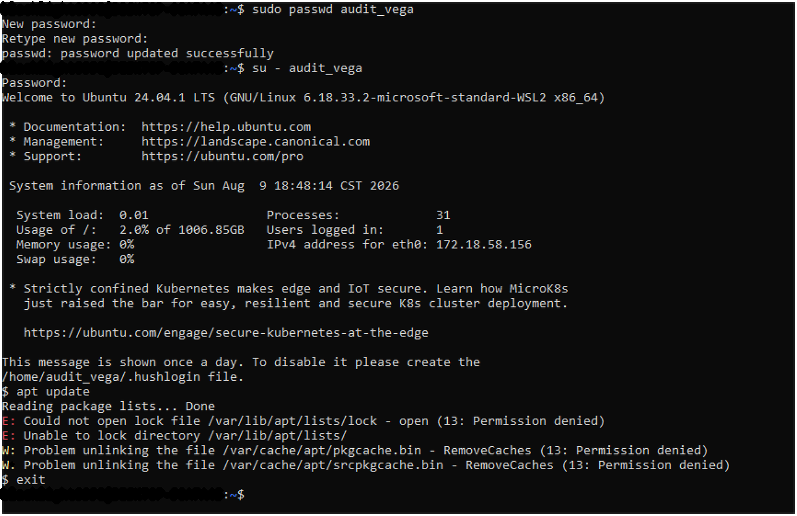
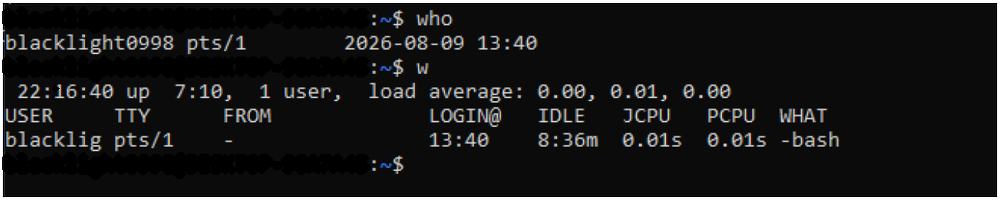
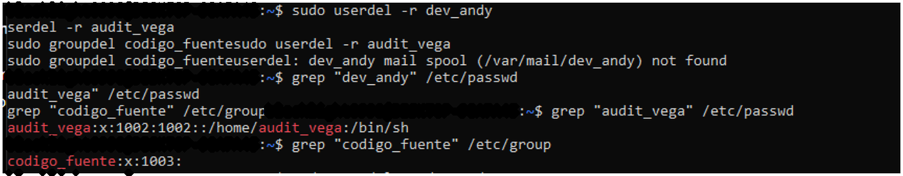

# Phase 2 — Linux Identity & Access Management

This is the access-control part of the [Linux Security Lab](../).

The exercise was based on a small company scenario where different users needed their own accounts instead of sharing a generic login.

## What I did

- created Linux users with home directories
- reviewed entries in `/etc/passwd`
- created and managed groups
- added users to groups
- tested privileged actions with `su` and `sudo`
- reviewed active sessions with `who` and `w`
- configured password aging with `chage`
- removed the temporary accounts and groups at the end

## Why the exercise was useful

The part I found most relevant was traceability. A shared administrator account may be convenient, but it makes it harder to know who did what. Using individual accounts and `sudo` makes administrative actions easier to associate with a specific user.

Groups also made more sense after using them in the lab. Instead of assigning access one person at a time, they provide a cleaner way to organize permissions for users with the same role.

## Evidence

### User creation and `/etc/passwd`

### Group management

### Privilege test

### Active session review

### Password aging

### Cleanup

For the password-policy exercise I used a 45-day maximum password age and a 5-day warning period.

The screenshots are from the original Ubuntu activity. Personal system identifiers were censored before publishing them.

## Context

This came from the Basic Operating Systems course at Universidad Fidélitas. I kept it in the Linux Security Lab because identity, privileges and session review are directly related to the administration and investigation work in the other phases.
