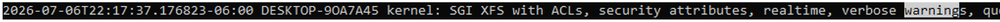
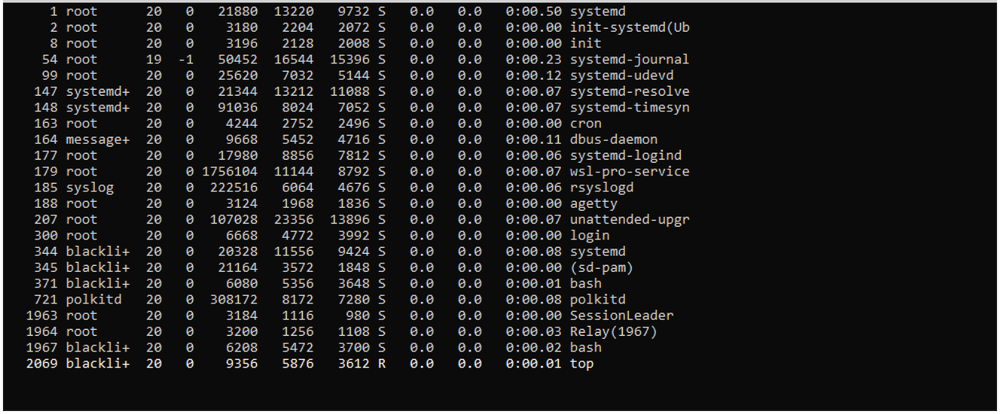

# Phase 3 — Linux System Diagnosis & Log Analysis

This is the troubleshooting/investigation part of the [Linux Security Lab](../).

The activity simulated a Linux system that was reported as slow. Instead of assuming the cause, I reviewed logs, processes and resource usage to see what the evidence actually showed.

## What I checked

- `auth.log`
- `kern.log`
- `dmesg`
- failed authentication attempts
- running processes with `ps`
- CPU and process activity with `top`
- memory usage with `free`

## What I found

There were failed authentication attempts in `auth.log`, but the rest of the evidence did not show that they were causing the reported performance problem.

The kernel output also contained WSL2/Hyper-V related warnings. I treated those as virtualization-related messages instead of automatically calling them a system failure.

The process and memory checks looked normal during the activity. CPU usage was mostly low and there was plenty of available memory.

The simulated slowness was not reproduced during the checks, so my conclusion was basically that there was not enough evidence to blame one specific cause.

That was useful because it forced me to separate a suspicious-looking log entry from an actual confirmed issue.

## Evidence

### Kernel warnings

### Process analysis

### Real-time monitoring

### Memory analysis

The screenshots come from the original Ubuntu activity. Personal system identifiers were removed before publishing them.

## What I learned

For me, this was the part of the Linux work that felt closest to basic incident investigation. The main lesson was to check several sources before deciding what happened: logs can show something interesting, but processes, resource usage and system context still matter.

## Context

This activity came from the Basic Operating Systems course at Universidad Fidélitas and is included here because it builds directly on the administration and access-control work from the other Linux sections.
