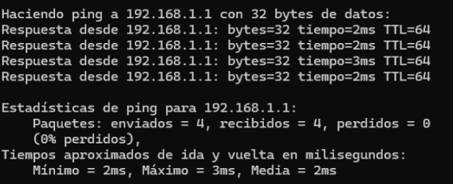
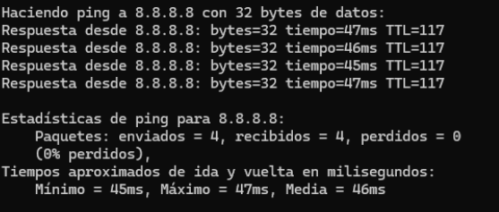
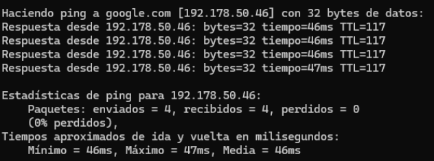
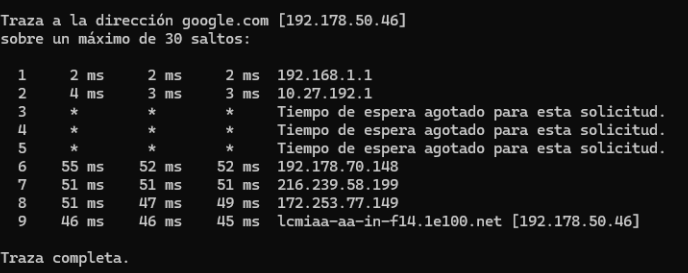

# Connectivity and Performance Tests

## Default Gateway Test

A `ping` test was performed against the local router at `192.168.1.1` to confirm local Layer 3 connectivity.

The router replied to all four packets with no packet loss.

## Internet Connectivity Test

A second test used the public address `8.8.8.8` to confirm connectivity beyond the local network without depending on DNS.

The destination replied successfully with no packet loss.

## DNS Resolution Test

The next test used `ping google.com` to verify both Internet access and DNS resolution.

The domain resolved to an IP address and returned replies successfully.

## Route Analysis

Windows `tracert` was used to follow the route from the local computer toward Google.

The first hop was the local gateway. Some intermediate hops timed out, but the destination was reached. These timeouts were not treated as proof of a network failure because intermediate routers may ignore traceroute probes.

## Bandwidth Test

The project also documented a Speedtest result of approximately:

- **Download:** 155.20 Mbps
- **Upload:** 157.18 Mbps
- **Latency:** 4 ms

The result was consistent with the documented 150 Mbps residential service.

## What I Practiced

- Testing the local gateway
- Separating DNS problems from general connectivity problems
- Reading packet-loss and latency results
- Following a route with `tracert`
- Basic network troubleshooting
