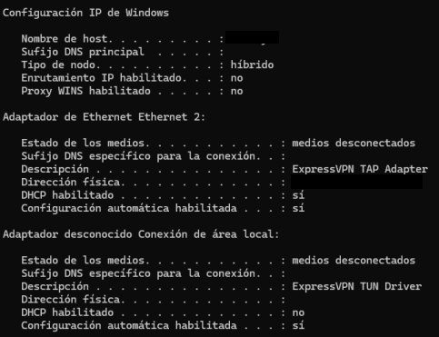
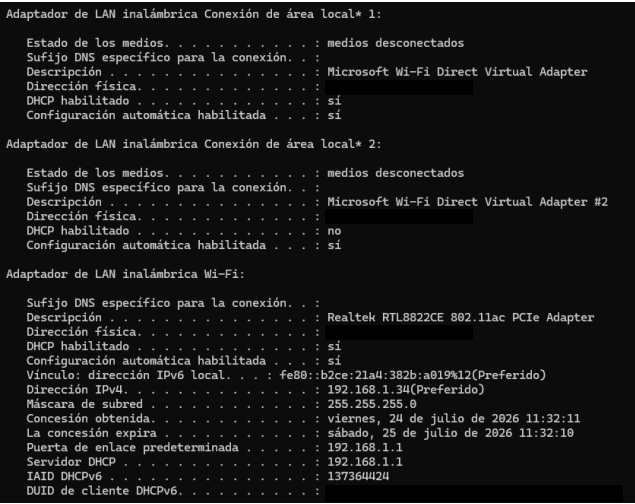
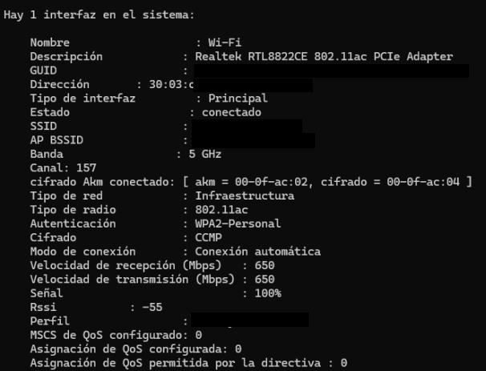

# Network Architecture

## Original Topology

The residential network used one router as the central device for Internet access, DHCP and Wi-Fi. The documented environment included a laptop, three mobile devices, a smart speaker and TV equipment.

## IPv4 and DHCP Configuration

The host was configured in the `192.168.1.0/24` private network and used `192.168.1.1` as the default gateway. DHCP was enabled on the router.

### Windows IP configuration

The screenshots are from the original project. Hostname, MAC addresses and other identifiers were redacted, while the addressing information used for the analysis was kept visible.

## Wireless Configuration

The connection showed:

- 5 GHz band
- IEEE 802.11ac
- WPA2-Personal authentication
- CCMP encryption
- 650 Mbps negotiated receive/transmit rate
- Strong signal during the test

The SSID, BSSID and other identifiers were redacted before publishing.

## Security Observation

All devices were connected to the same LAN. This makes administration simple, but it also means trusted user devices and less-trusted IoT devices share the same local segment.

A future improvement would be to move IoT and multimedia devices to a guest network or separate VLAN when supported by the router.
