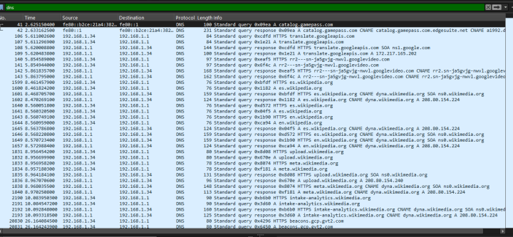
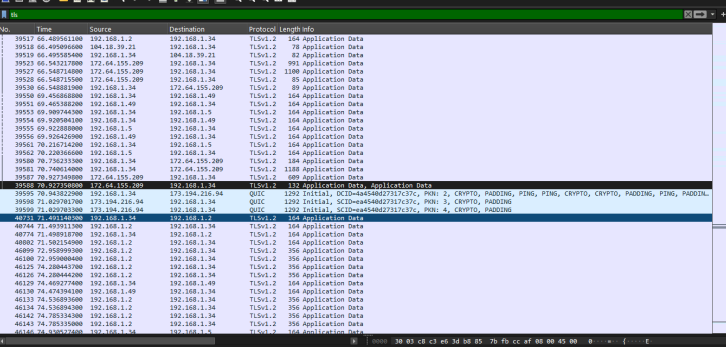

# Wireshark Traffic Analysis

## Objective

Wireshark was used to inspect traffic generated on the residential network and identify the main protocols present during the capture period.

## Packet Capture Evidence

### Capture 1

### Capture 2

### Capture 3

These screenshots come from the original project and were kept as real evidence instead of recreating the packet data.

## Protocols Observed

### TCP

TCP was one of the predominant protocols in the capture. This matched normal web and application traffic that depends on reliable transport.

### TLS 1.2

TLS 1.2 traffic was also visible, showing that much of the Internet communication was encrypted in transit.

### SSDP

SSDP traffic appeared inside the local network. This made sense because the environment included smart and multimedia devices that use service discovery.

### IGMP

IGMP traffic was observed and was associated with multicast-related communication.

### ICMPv6

ICMPv6 packets were present as part of normal IPv6 network functions.

## Assessment

During the capture period, the traffic looked consistent with normal residential activity. We did not identify an obvious malicious pattern in the captured sample.

That does not mean the network was guaranteed to be threat-free; the analysis only represents the traffic visible during the capture window.

## What I Practiced

- Reading packet captures
- Identifying protocols
- Comparing local and Internet traffic
- Recognizing encrypted TLS traffic
- Understanding discovery and multicast traffic
- Building a basic picture of normal network behavior
