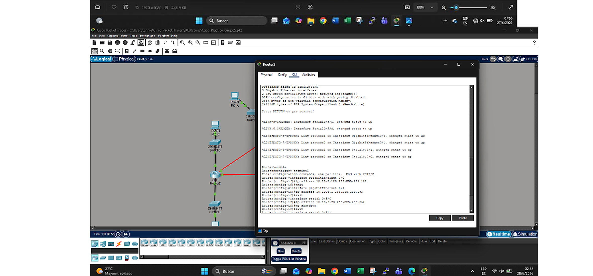

# Packet Tracer VLSM Network Lab

This was a university networking activity built in Cisco Packet Tracer.

The starting network was `10.10.0.0/21`. The goal was to divide it with VLSM so several LANs with different host requirements could fit without wasting too much address space, then apply the plan to a topology with three routers.

## What I worked on

- VLSM subnetting
- IPv4 addressing
- /24, /25, /26 and /30 networks
- Router interface addressing
- Point-to-point links
- Cisco Packet Tracer
- Connectivity testing

## Topology

Each router connects two LANs, and the routers are linked to each other with three /30 point-to-point networks.

## Addressing plan

| Network | Hosts needed | Network | Prefix |
|---|---:|---|---:|
| A | 240 | 10.10.0.0 | /24 |
| B | 192 | 10.10.1.0 | /24 |
| C | 150 | 10.10.2.0 | /24 |
| D | 120 | 10.10.3.0 | /25 |
| E | 85 | 10.10.3.128 | /25 |
| F | 40 | 10.10.4.0 | /26 |
| R1-R2 | 2 | 10.10.4.64 | /30 |
| R2-R3 | 2 | 10.10.4.68 | /30 |
| R1-R3 | 2 | 10.10.4.72 | /30 |

I assigned the largest LANs first and used /30 networks for the router-to-router links because they only needed two usable addresses.

[View the full subnetting plan](./subnetting-plan.md)

## Router configuration

The router interfaces were configured from the VLSM plan instead of treating the subnet calculations as a separate paper exercise.

[View router addressing](./router-addressing.md)

## Testing

After the addressing was in place, I checked connectivity between PCs and their gateways and between routers.

[View testing notes](./testing.md)

Additional interface/routing evidence:

## What I learned

The useful part of this exercise was seeing how the subnetting plan affected the actual topology. It helped me connect host requirements, masks, gateway addresses and router interfaces instead of thinking about each one separately.

## Context

This was completed as a university group activity for the Principles of Networks and Communications course. I kept the networking work and a few screenshots from the original activity rather than uploading the full academic report.
