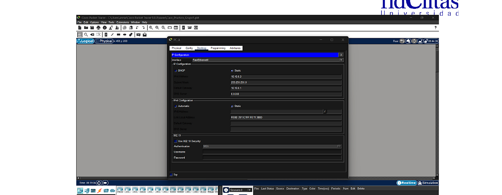
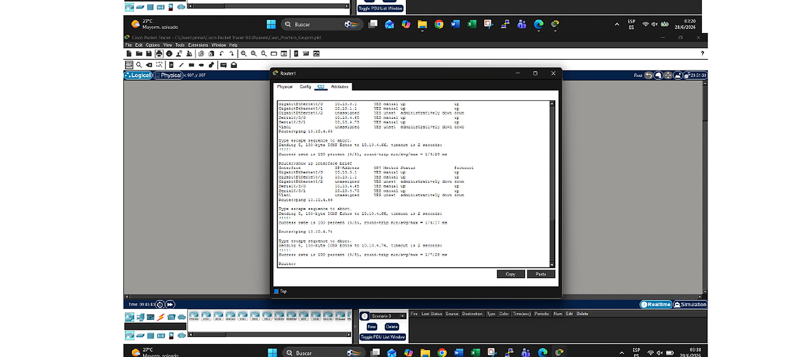

# Router Addressing

The router interfaces were assigned according to the VLSM plan.

## Router 1

| Interface | Connected network | IP address | Mask |
|---|---|---|---|
| G0/0 | Subnet A | 10.10.0.1 | 255.255.255.0 |
| G0/1 | Subnet B | 10.10.1.1 | 255.255.255.0 |
| S0/3/0 | R1-R2 | 10.10.4.65 | 255.255.255.252 |
| S0/3/1 | R1-R3 | 10.10.4.73 | 255.255.255.252 |

## Router 2

| Interface | Connected network | IP address | Mask |
|---|---|---|---|
| G0/0 | Subnet C | 10.10.2.1 | 255.255.255.0 |
| G0/1 | Subnet D | 10.10.3.1 | 255.255.255.128 |
| S0/2/0 | R1-R2 | 10.10.4.66 | 255.255.255.252 |
| S0/2/1 | R2-R3 | 10.10.4.69 | 255.255.255.252 |

## Router 3

| Interface | Connected network | IP address | Mask |
|---|---|---|---|
| G0/0 | Subnet E | 10.10.3.129 | 255.255.255.128 |
| G0/1 | Subnet F | 10.10.4.1 | 255.255.255.192 |
| S0/3/0 | R2-R3 | 10.10.4.70 | 255.255.255.252 |
| S0/3/1 | R1-R3 | 10.10.4.74 | 255.255.255.252 |

## Evidence

This part of the lab helped connect the subnetting calculations with the actual router interfaces in Packet Tracer.
