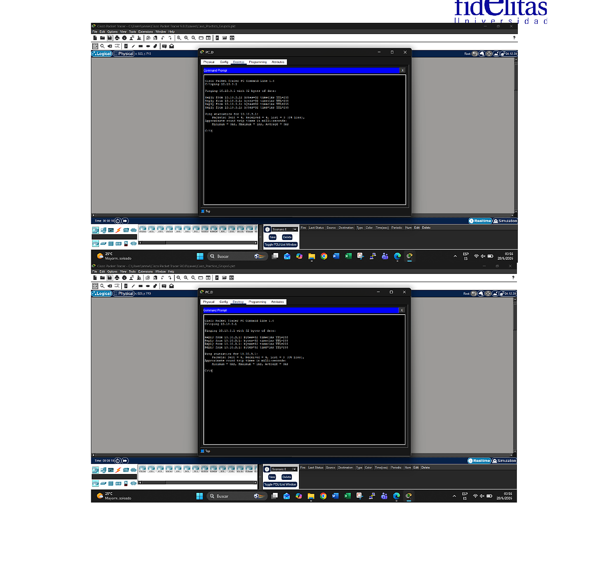

# Connectivity Testing

After the addressing and router interfaces were configured, the topology was tested inside Cisco Packet Tracer.

The evidence from the original activity includes:

- Connectivity tests from PCs to their default gateways
- Tests between the routers through the point-to-point links
- Interface status and addressing checks
- Router CLI output

The purpose was to confirm that the addressing plan was applied correctly and that the links were operational.

## What I checked

1. Each LAN device had an address from the correct subnet.
2. The configured gateway matched the router interface for that LAN.
3. Router serial links used the correct /30 networks.
4. Interfaces were active.
5. Ping tests returned successful replies.

## Evidence

The screenshots used in the portfolio come from the original Packet Tracer activity instead of recreating the lab only for GitHub.
