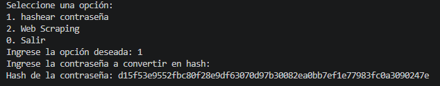
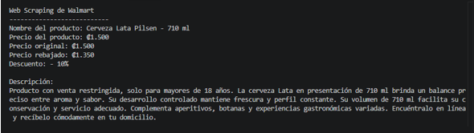

# Web Security & Scraping Exercise

This project came from an Advanced Programming university case study.

The goal was to combine several Python topics in one small application: login validation, password handling, regular expressions, web scraping and basic security-related logic.

I kept the project close to the original coursework instead of rebuilding it into a larger application.

## What it does

The program:

- generates a random password using `secrets`
- validates a username using a regular expression
- uses `getpass` for password input
- compares the entered password with the generated password
- generates a SHA-256 hash from a password
- performs web scraping with `requests` and `BeautifulSoup`
- extracts product information using HTML parsing and regular expressions
- runs through a simple command-line menu

## Execution evidence

### Password hashing

This capture shows the command-line menu and the SHA-256 hash generated from a password entered with `getpass`.

### Web scraping

The scraping output includes the product name, original and discounted prices, discount percentage and additional product information extracted from the page.

## Small improvement from the original version

The original exercise used AES-EAX to encrypt a password.

For the portfolio version, I changed only that part to demonstrate password hashing with SHA-256 instead of reversible encryption.

This is still a learning exercise. SHA-256 by itself is not the approach I would use for password storage in a real authentication system; a password-specific algorithm such as Argon2, bcrypt or scrypt would be more appropriate.

## Libraries

- `secrets`
- `string`
- `re`
- `getpass`
- `hashlib`
- `requests`
- `BeautifulSoup`

## Files

- `web_security_scraping.py` — main program
- `screenshots/` — execution evidence

## Context

This was completed as a university programming exercise and later adapted for the portfolio. The web scraping was performed for academic practice.
