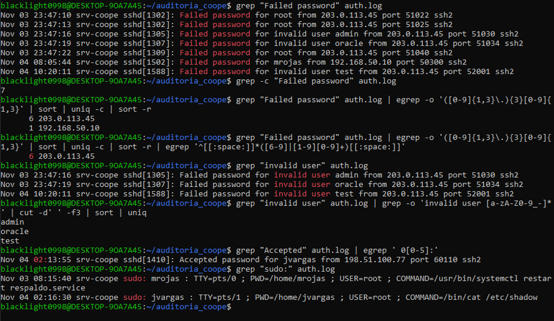
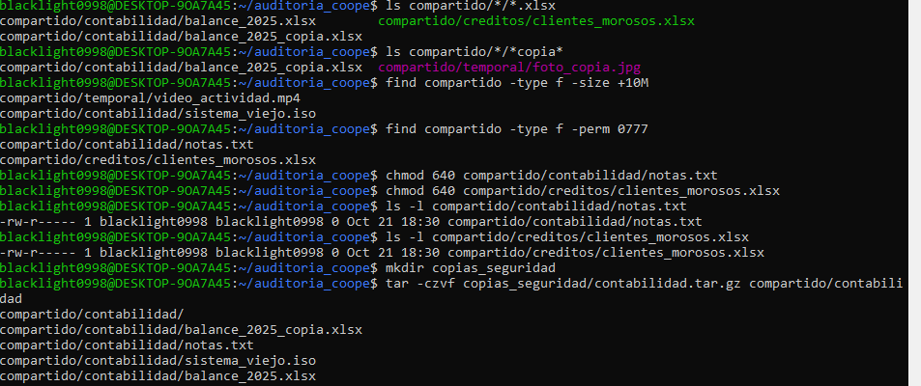
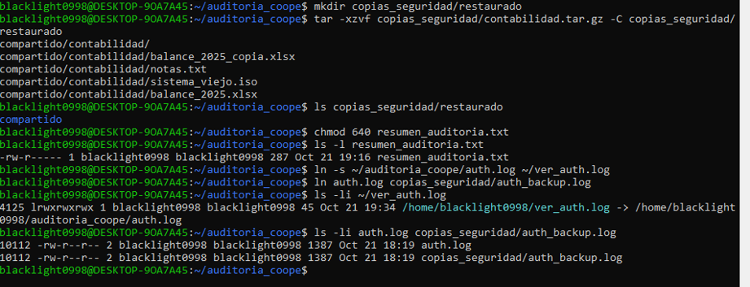
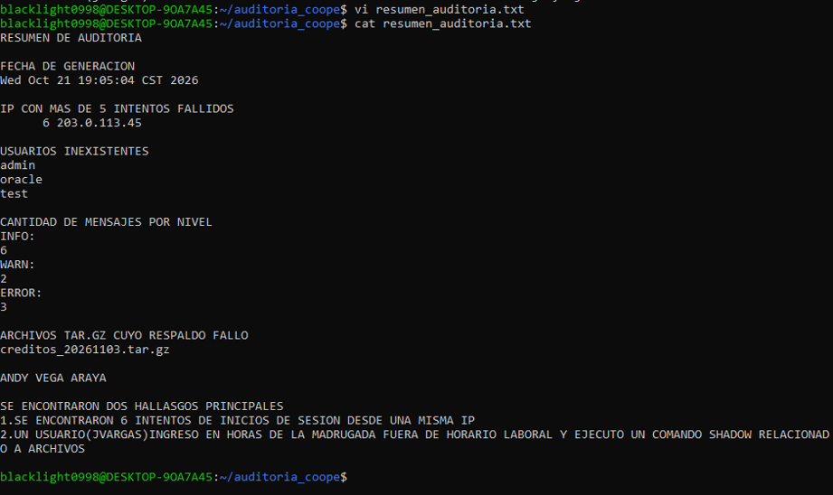

# Linux Log Audit & Security Review

This case study came from my Intermediate Operating Systems course. The scenario was a simulated Linux server with suspicious SSH activity, backup failures and file-permission issues.

I kept it in the portfolio because it was one of the first exercises where I had to do more than run Linux commands: I had to read logs, separate normal activity from suspicious activity and write down what I would change.

## What I worked on

The lab used two main log files:

- `auth.log` for SSH authentication attempts and commands executed with `sudo`
- `respaldos.log` for scheduled backup activity, warnings and errors

I used tools such as `grep`, regular expressions, `sort`, `uniq`, `find`, `chmod`, `tar`, `vi` and shell redirection.

Some of the tasks included:

- counting failed SSH login attempts
- extracting source IP addresses from the authentication log
- identifying invalid usernames
- reviewing successful logins during unusual hours
- checking commands executed with `sudo`
- separating INFO, WARN and ERROR messages from backup logs
- locating files with unsafe `777` permissions
- creating a compressed backup and restoring it
- generating a short audit report from the command line

### SSH log analysis

## Findings

The simulated logs contained a few things worth investigating.

### Repeated failed SSH attempts

One source address, `203.0.113.45`, generated six failed login attempts using accounts such as `root`, `admin` and `oracle`.

For this type of activity I would review SSH configuration, limit repeated authentication attempts and consider blocking the source if the activity continued.

### Suspicious privileged activity

The user `jvargas` logged in during the early morning and later used `sudo` to read `/etc/shadow`.

That does not prove the account was compromised, but it is activity I would want to verify because the file contains sensitive account information.

### Backup and permission problems

The backup log also showed repeated disk-full errors and a file with `777` permissions.

I corrected the insecure permissions in the exercise and documented disk-space monitoring and cleanup as part of the recommendations.

### File permissions and backup work

### Backup restoration and links

### Final audit summary

## What I learned

The useful part of this case for me was connecting Linux administration with basic security investigation.

Instead of treating each command as an isolated exercise, I had to use several commands together to answer questions from the logs and support the conclusions with evidence.

This was a university case study using simulated data, not a production incident.
